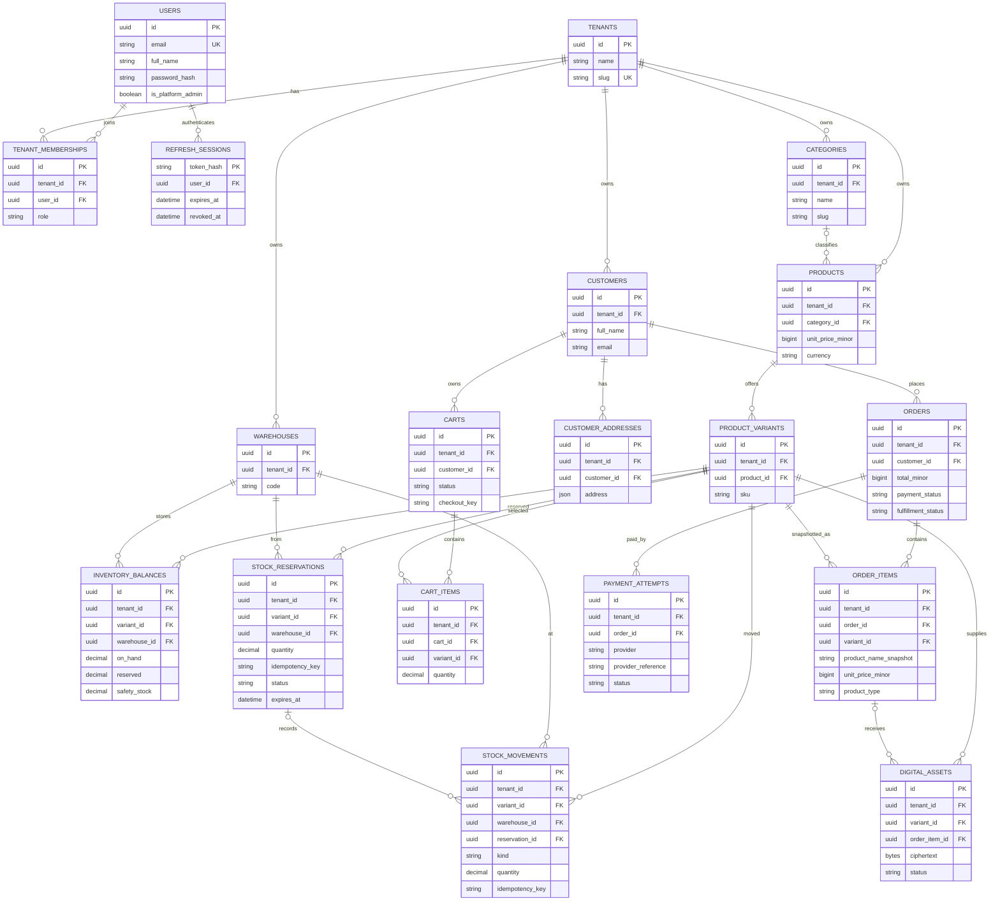

# Entity Relationship Diagram

Current Sprint 1-3 schema from `commerce_api/db/models.py`:

The diagram omits secondary unique constraints, audit timestamps, and RLS policy predicates. Every commerce relationship includes tenant identity in its database constraints. The legacy Telegram bot schema is intentionally separate.